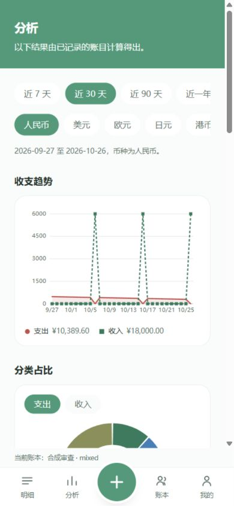
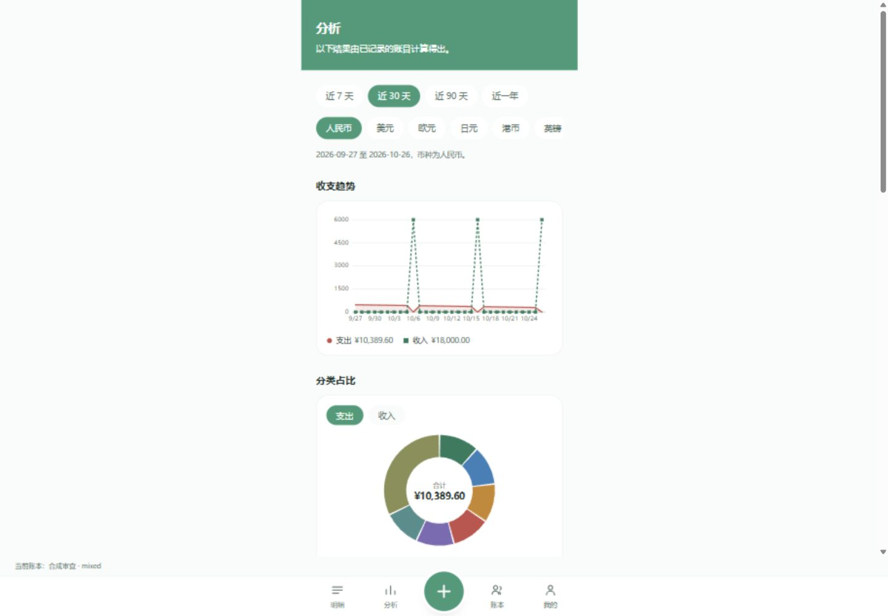
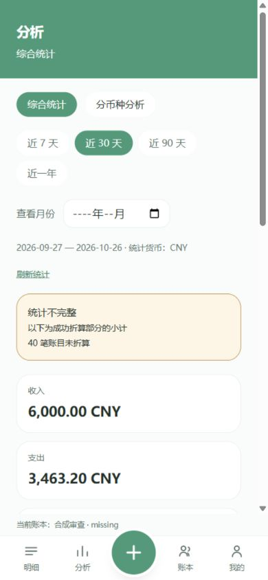
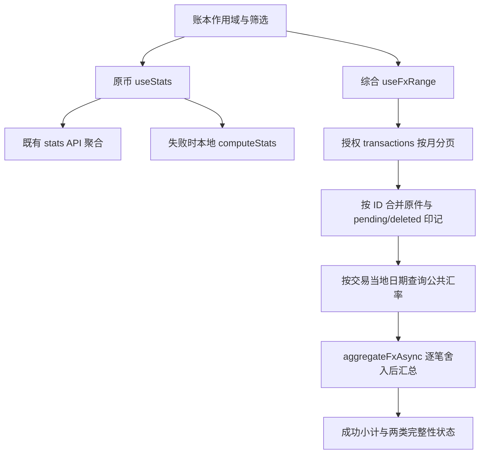

# 分析页面全面升级：现状审查与方案提案

> 最后核对: `335da77`（调查基线）+ 本轮本地 P0 修复差异 / 2026-10-26。
> 性质：产品与技术审查、待选方案。原始要求为只调查；所有者随后明确授权先处理多币种布局、模式切换和财务正确性的 P0。本文把基线问题、已做修复和待选 P1 分开。执行状态统一见 [STATUS](../../STATUS.md)。
> 目录沿用 `docs/specs/design/`，不另建第二套设计目录。本轮称谓“S17-A 分析升级”不覆盖既有 S17-A 安全与隐私材料，也不擅自改写整个 S17 路线图编号。**【2026-10-26 更正】该称谓废止，见 §0.4。**
> **【2026-10-26 更新】**所有者已在三套方案中选定“扩展版 C”，§1、§11、§15 的“B 为主体 + C 有限组合”推荐不再是最终产品决策。新方向、对照与状态变化集中记录在 **§0**；§1–§15 的原文与证据保留不动，仅在受影响处加注。

## 0. 2026-10-26 所有者决定与本文状态变更

> 本节为 2026-10-26 追加。**§1–§15 的原文与证据完整保留，没有删改**，只在受影响处以“【2026-10-26 更新】”注记。调查证据、素材目录和原始问题编号（F01–F18）继续有效。

### 0.1 决定【已确认】

所有者阅读本文后决定：在 A / B / C 三套方案中**直接采用 C，并进一步扩大其目标**——不再只是增加图表、改善布局或实现分类点击，而是建设 **Libevra Modular Analytics Workspace（中文暂称：Libevra 模块化财务分析工作台）**：用户可配置的卡片工作台、每张卡片独立的分析详情页、用户主动进入的编辑模式与布局容器、个人配置与布局分享。完整需求见 [S17 总需求规格](../../specs/product/S17-模块化财务分析工作台-总需求规格.md)；开发路线见 [S17 / S18 新路线图](../../specs/product/S17-S18-新路线图.md)。

### 0.2 对本文原结论的影响

| 位置 | 原表述 | 现状态 |
|---|---|---|
| §1、§11 “推荐混合方案”、§15 首行 | 推荐“B 为主体，吸收 C 的上下文保留与桌面布局（有限组合）” | **不再是最终产品决策**，保留为历史记录。其中的原则——先统一口径、每个金额可追溯、区分完整 / 缺汇率 / 缺原件、不改变财务合同——被新方向继承为 ACC-01…15 |
| §11 的 C 方案 | 总览 / 变化 / 探索三种任务视图 + 桌面检查器，仍以个人 / 家庭手机为主 | 被扩展，见 §0.3 |
| §12 开发路线 0–9 | 面向 B+C 的阶段 | 被新路线图 S17-W1…W6 取代；本表继续作为“口径先于视觉、来源链路先于图表”等关口的来源 |
| §9 少而有用的新增能力 | 变化贡献、最大单笔来源、依据入口等 8 项 | 转为[分析能力目录](../../specs/features/S17-分析能力目录.md)的条目并按可行性分档 |
| §10 技术可行性与架构代价 | 不换图表库、不建分析数据库 | 仍有效；见[图表与卡片规格](../../specs/design/S17-图表与卡片规格.md) §6 |
| §15 其余决策行 | 默认范围、点选行为、综合占比、年度 / 日历、桌面、变化提醒 | 并入[待确认问题](../../specs/product/S17-待所有者确认的问题.md)或新规格中的对应【待决策】；“转账与账户：独立立项”继续有效 |

### 0.3 扩展版 C 与原 C 的对照

| 维度 | 本文 §11 的 C | 扩展版 C（本次决定） |
|---|---|---|
| 页面形态 | 总览 / 变化 / 探索三种任务视图 | 用户可配置的卡片工作台，视图由卡片与模板组成 |
| 图表单元 | 若干联动图表 | 大量独立、可配置的分析卡片；同一分析可多次出现，每个实例有自己的配置与身份 |
| 尺寸适应 | 手机单列 + 桌面双列 | 卡片按父容器真实宽高自适应，不依赖固定断点或列数 |
| 详情 | 来源检查器 | 每张卡片独立、完整的分析详情页 |
| 布局 | 固定信息架构 | 编辑模式、网格、拖动 / 缩放、布局容器（自由分割 / 滑动抽屉） |
| 配置 | 可选“观察书签” | 个人布局持久化、跨设备适配、导出 / 分享 / 导入 |
| 模板 | 无 | 优质默认工作台 + 多套预设模板 |
| 全站适配 | 仅分析页放宽 | 分析系统先具备响应式基础，全站桌面 / 横屏适配另立 S18 |

### 0.4 称谓更正

本文开头的“S17-A 分析升级”称谓**废止**：它与既有 S17-A（法律、隐私与合规）冲突。现统一称“S17 分析工作台”（阶段 S17-W1…W6）；原 S17（正式公开发布准备）2026-10-27 确认顺延为 **S19**（此前一度称“公开发布线”），任务 ID 沿用 `S17-A…F`（等同 `S19-A…F`）。详见[新路线图 §2](../../specs/product/S17-S18-新路线图.md)。

### 0.5 P0 修复状态（以 §13 为准，此处只摘要）

- 多币种布局、模式切换、财务正确性的 P0 代码仅存在于**主工作区的未提交差异**（本地候选 `1.16.23`，主工作区 HEAD 仍在 `335da77`，落后于 `origin/main`）；**未提交、未合并、未发布、未经真机 Safari / PWA 验收**；
- 如何处置（先发布 / 并入 W1 / 重做）待所有者决定，见[待确认问题 Q-06](../../specs/product/S17-待所有者确认的问题.md)；
- 本文 §3–§12 的其余 P1 项**全部未开发**。

### 0.6 编号对照

本文的问题编号 F01–F18 保持不变，新规格以 F 编号引用（例如总需求规格 ACC-09 引用 F01）。

## 1. 结论与阅读方式

推荐 **B 为主体，吸收 C 的上下文保留与桌面布局**。目标是把“陈列统计图”变为“理解本期收支 → 找到变化 → 查看来源”的完整路径。现有 React、SVG、主题令牌和逐笔汇率引擎足够承担主体工作，暂不需要换图表库或建立分析数据库。

> **【2026-10-26 更新】**上述“B 为主体”推荐已被所有者的扩展版 C 决定取代（见 §0）。“目标路径”“现有技术足够、暂不换库”的判断仍成立。

优先级高于动画的四件事：统一时段与统计口径；让每个重要金额可追溯；区分完整、缺汇率、缺原件；在原币与综合模式中保留相同操作语法。好看的曲线不能弥补下钻看到另一段账目的问题。

本文证据标识：**观察**＝本轮浏览器运行真实组件、合成数据确认；**源码**＝沿实际调用链确认；**待验证**＝有疑点但没有足够运行证据；**建议**＝产品取舍，不是已确认缺陷。视觉偏好不按 Bug 统计。

本轮没有登录生产、读取真实账本、调用外部汇率 API、上传、push 或部署。公开产品研究只查询公共资料，不发送项目源码或财务数据。后续补充要求中的“真实交易一致性”只以真实 DTO 形状的合成流水和既有纯函数测试核对；**未核对任何真实用户账目**。

## 2. 有效基线与运行环境

开工主工作区是 `b6ce25e`，简报记录的发布基线落后。沿本地分支/worktree 找到 `release/1.16.21` 的 `335da77`；其简报与版本、59 个迁移一致，因此按仓库规则信任该简报，没有重复调查生产。

所有者随后授权整理 worktree：主工作区快进到 `335da77`，快照 `codex/snapshot-before-s17-20261026` 保留原 HEAD；原 R4 索引稿保存在 stash，并恢复文字内容，把只存在本机的素材路径保留为代码文本，避免重新引入 CI 失效链接。P0 前另有 `codex/snapshot-before-s17-p0-20261026`。没有删除 worktree。头像 `71546db` 是独立候选，包含新增迁移；本轮没有混入或执行该迁移。

隔离运行方式：真实 Vite 页面与发布源码；本机合成 API，内存生成流水、返回公共汇率夹具；API 只监听 `127.0.0.1:3037`，页面入口 `5197–5206` 均为回环地址。不同案例使用不同 origin，避免查询缓存互相污染。未连接 PostgreSQL，未启动正式 API，未种入开发库。

夹具与请求记录位于本机 `_backups/s17-analysis/`；可交付截图、文字记录和测量 JSON 见 [素材目录](分析页面审查素材/README.md)。这些是**真实页面配合成数据**，不是生产截图、真机截图或重新画的效果图。早期夹具曾缺少奖励/冲突响应字段，已修正；该阶段控制台错误不归因于产品。综合统计冷进入两次需要手动刷新才结束加载，尚不能排除模拟身份/作用域时序影响，列为专项复核，不当作已证实生产缺陷。

## 3. 基线功能清单与源码对应

| 区域/能力 | 基线行为 | 入口与关联组件 |
|---|---|---|
| 页面身份 | 当前账本、分析标题、底部导航；账本提示不在顶部重复 | [StatsPage](../../../apps/web/src/pages/StatsPage.tsx)、[Layouts](../../../apps/web/src/components/Layouts.tsx)、`TabPageHeader` |
| 相对时段 | 近 7/30/90/365 天；默认近 30 天；设备当地今日 | `StatsPage`、[共享统计定义](../../../packages/shared/src/stats.ts) |
| 原币筛选 | 六币种独立选择，默认用户偏好币种；不相加 | `StatsPage`、[queries](../../../apps/web/src/lib/queries.ts) |
| 原币趋势 | 支出面积/实线、收入虚线/方形标记，同轴；指针点选与拖动查看桶值 | [TrendChart](../../../apps/web/src/components/charts/TrendChart.tsx) |
| 分类结构 | 收入/支出切换；前六分类加“其它 N 项”；图例带金额、整数占比及形状 | [CategoryDonut](../../../apps/web/src/components/charts/CategoryDonut.tsx) |
| 分类下钻 | 点击图例立即转明细，只传 categoryId 与结束月份 | `StatsPage` → [DetailPage](../../../apps/web/src/pages/DetailPage.tsx) |
| 比较 | 本期收入/支出与比较期变化，前期为零显示横线 | [SummaryPanel](../../../apps/web/src/components/charts/SummaryPanel.tsx) |
| 本期概览 | 日均支出、最大单笔金额 | `StatsPage`、`averagePerDay` |
| 热力图 | 本月/近七天独立切换；按非零支出分位数着色；点日显示金额/档位 | [CalendarHeatmap](../../../apps/web/src/components/charts/CalendarHeatmap.tsx) |
| 年度总览 | 设备当年全年收支、差额、笔数、各月支出柱；点击柱查看数值 | `SummaryPanel` |
| 折算开关 | 账号隔离的本设备偏好，默认关闭；目标是用户默认币种 | [fxView](../../../apps/web/src/lib/fxView.ts)、`FxModeSetting` |
| 综合统计 | 收入/支出/差额；指定历史月；月份条形列表、分类金额列表；不显示占比 | [FxStats](../../../apps/web/src/components/FxStats.tsx) |
| 综合完整性 | 成功小计、缺项数与账目链接、原币汇总、来源说明、待复核提示 | `FxStats`、[FxDisplay](../../../apps/web/src/components/FxDisplay.tsx) |
| 渲染基础 | 手写 React SVG；DOM 热力格与综合条形；无第三方图表依赖 | [ChartFrame](../../../apps/web/src/components/chart/ChartFrame.tsx)、`Axis`、`Legend`、`useElementWidth` |
| 主题/双语 | 数据收入/支出色与品牌色分离；八分类色、五热力色；预置分类译名，自建名称保留 | [图表主题](../../../apps/web/src/lib/chart/theme.ts)、[CSS](../../../apps/web/src/index.css)、`i18n/resources/{zh-CN,en-US}/{stats,fx}.ts` |

**原币与综合模式的事实区别**：基线原币模式的图表种类更多；综合模式提供更明确的本期三项摘要及缺汇率解释，但图形和下钻更少。补充需求中关于两者能力的描述，不能当作“某个图表曾实现后被删除”的证据；本轮没有发现这样的提交证据。

### 3.1 实际阅读路径

原币：页头 → 时段横条 → 六币种横条 → 时间说明 → 双系列趋势 → 环图及七行图例 → 收入/支出环比 → 日均/最大单笔 → 独立本月热力 → 独立当年总览。

综合：页头 → 模式入口 → 时段按钮 → 原生月份输入 → 范围/目标/刷新 → 完整性说明 → 收入/支出/差额三卡 → 月份列表 → 分类金额列表 → 缺项账目 → 折叠原币总额 → 来源。

原币分类图例 → `/?categoryId=…&month=结束月` → 当月明细 → 单笔详情。趋势选点、年度选月、热力选日均不进入交易来源，也不联动其他模块。

### 3.2 真实截图







## 4. 问题与优先级：事实不等于审美结论

| 编号 | 证据 | 发现、用户影响 | 处理归属 |
|---|---|---|---|
| F01 | 观察+源码 | 近 90 天分类下钻落入结束月份，且没有传币种、收支；来源金额可能与图表不一致 | P1 核心，下钻合同优先于新动画 |
| F02 | 观察+源码 | 90 天的比较说明却写“上月同期、本期尚未结束”；真正比较区间是前一个等长窗口 | P1 必修文案与比较模型 |
| F03 | 观察+源码 | 返回分析重置近 30 天，选择状态缺少导航载体 | P0 已把时段/模式/币种/收支接入 URL；图表选点尚未恢复 |
| F04 | 观察+源码 | “其它 3 项”可以占 31%–32%，却禁用且没有展开入口 | P1，聚合尾部必须可展开 |
| F05 | 源码 | 扇区 path 没有点击事件；图例设置 activeId 后立即离页，无法形成稳定选中体验 | P1，先检查再查看账目 |
| F06 | 观察+源码 | 切到分币种模式只剩“综合统计”按钮，当前模式没有持续可见的选中项 | P0 已修复共同双按钮与 aria-pressed |
| F07 | 观察+源码 | 收入只有工资一类，选“收入”后仍提示“仅有一项支出”；热力图以总笔数判断已有记录，只有收入却写“金额均为零” | P1，按指标说明无支出/单分类 |
| F08 | 观察+源码 | 原币首屏总金额在趋势底部，当前范围差额没有集中摘要；年度差额很深且口径不同 | 信息架构建议，不判财务 Bug |
| F09 | 观察+源码 | 全局近 90 天、热力本月、年度当年同时出现；标题有范围但用户需不断切换理解口径 | 建议统一主范围，独立观察项降到按需展开 |
| F10 | 源码 | 年度柱只画支出，原币趋势无法单独看支出/收入；工资峰值会压扁消费变化 | 建议默认支出，收支比较按需开启，共用刻度 |
| F11 | 观察+源码 | 桌面 1440px 内容仍为 max-w-md 单列，空间未用于对照与来源 | C 的布局机会，窄单列本身不是缺陷 |
| F12 | 源码 | 趋势覆盖 rect 只有 pointer 操作，年度 rect 只有 click；SVG 的 role=img 和标题不是键盘/数据表的替代 | P1 必做可访问性 |
| F13 | 源码 | 综合提前 return 之前，三次 useStats 已执行；综合仍可能请求主区间/年度/热力原币统计 | P1 查询按模式与可见区域启用，不能仅隐藏组件 |
| F14 | 源码+测量 | 本地三组统计重复过滤；大样本同步工作可超过一帧。综合逐日串行汇率请求和分页才可能是更大的冷启动成本 | 性能工程，不能仅凭桌面体感宣布达标 |
| F15 | 源码 | 年度/热力请求失败后，没有各自错误分支，可能一直显示骨架 | P1 局部失败反馈 |
| F16 | 用户报告+源码+本轮预览 | 折算主摘要套入固定 128px 的动画外壳，内容高度大于外壳；白色普通卡覆盖半透明语言 | P0 已适配自然高度并复用卡片样式；iPhone 实机待验 |
| F17 | 源码 | 折算开启仍用 others 列表，默认币种原币卡被省略；综合小卡直接在零宽 twin 上加 padding，又被 twin CSS 清为零 | P0 已补全原币卡、把 padding 放回内部 |
| F18 | 源码 | 环图按排序索引着色，换时段后同分类可能换颜色；扇区两端各减 0.8°，极小比例可能完全无 path | P1 可读性，不能用扩大比例造假解决 |

待验证事项：综合冷启动的加载时序；跨午夜不卸载页面时 today 不刷新（useMemo 空依赖）；Safari 中 pointer capture 与纵向滚动竞争；原币多笔总额超过 number 安全整数后的精度。后者源码使用 number 求和，输入单笔安全不代表总和安全，需边界测试，不能据此断言已有真实账本算错。

## 5. 数据链路、财务合同与权限边界



原币 API 的实际筛选：当前授权 bookId、deletedAt=null、occurredLocalDate 区间、currency。响应有 totals、series、byCategory、comparison；**没有来源流水 ID、最大单笔 ID、分类笔数、分类前期值、周桶或任意维度组合**。服务端 totals、series、category 及比较分别聚合；不能把文件注释“只三次查询”当实测 SQL 数。

离线 `useStats` 复用 ledger store、月份原件、查询缓存和 `computeStats`，与 API 共用日期补桶。网络回退实码是 1,000ms，不照抄旧文档的两秒描述。原币本地统计没有像综合一样的范围完整性凭据，因此“本机有一些记录”不能推出“全年确实为这些总额”。需要补显示上的完整性合同；不得借机改预下载范围或抛弃本地数据。

综合在线按月获取全币种原件、Map 按 ID 去重，再与本地待同步/删除印记合并；范围上限 14 个月、100,000 笔。离线原件完整性凭据只存 ID，公共汇率缓存不存账目。汇率完整与原件完整是两件事；`complete && sourceComplete` 才是完整视图，`needsReview` 又是第三个独立状态。API 返回真正 HTTP 错误时的处理与网络不可达并不相同。

### 5.1 升级不能改变的语义

权威合同是 [S16-D 规格 §2、§5、§7](../../specs/features/S16-D-历史汇率与折算基础设施.md)，这里解释对 UI 的约束，不新建规则：

- 使用每笔当地交易日期，来源 ECB 经 Frankfurter；不是录入日、今天或银行实际成交价。允许的历史回退仍是最多七个日历日，保留请求日和实际日。
- 汇率十进制字符串 → BigInt 有理数计算 → 每笔目标最小单位舍入 → 汇总逐笔显示金额。不得先合币种再乘汇率。
- 原币 DTO 是安全整数 number；折算及汇总是整数字符串。绘图可以把有界比例转换为 number，金额文本不能这样做。
- 原始金额、币种、日期、账本、导入导出不变。切换目标币种只重新派生，不能写回历史。
- 不同币种原额不相加、不同单位不共用一把未注明的金额尺。币种对比要么各自分面，要么明确同一目标币种和参考规则。
- 缺汇率的账目不补零、不进入“完整占比”的分母；保留原币和缺项入口。缺原件时甚至无法知道准确总笔数，不显示虚构覆盖率。
- 既有金额非负，收入/支出由 kind 表达；净收支允许负，环图扇区不承载负值。异常负原件应解释为不可用于此图，不能取绝对值造图。

### 5.2 重复计算、转账与共享

未发现“综合金额再加一次原币总额”的求和路径；`originalByCurrency` 是另一份展示，不参与再次累加。`mergeFxOriginals` 保留待同步新建/编辑，过滤本机删除，不复活服务器已删旧副本。已有测试覆盖 ID/版本合并、目标精度、超大字符串和缺汇率等；这不证明任何外部导入一定无重复。

项目现有流水 kind 为 income/expense，支付方式不是资金账户；**没有可据以自动识别账户间转账的 transfer 数据合同**。用户把转账记成收支时，引擎会如实统计。自动排除需要先定义转账/成对关联、单边导入、跨币种费用、撤销和历史兼容，不在本次 P0 猜测或批量回写。这一新产品模块可能涉及字段、API、迁移，应独立立项。

共享账本仍使用现有成员 read guard；管理员不自动有账本访问权；UI 下钻不得自行过滤出“看似有权限”的副本。个人离线写与共享离线只读、退出/账号/账本切换隔离全部保留。新查询若增加必须追加验证，不移动或抽取敏感判断。

## 6. 产品参照研究：借鉴任务路径，不复制财务模型

| 官方资料 | 可借鉴的原则 | Libevra 不直接照搬 |
|---|---|---|
| [YNAB Spending Trends](https://support.ynab.com/en_us/spending-trends-H1inlhzAc) | 从整体到分类再到来源账目，侧边摘要随观察层次变化 | 预算分类组与转账统计口径不等于本项目 |
| [YNAB Spending Breakdown](https://support.ynab.com/en_us/spending-breakdown-H1H7YxmD0?mobile-help=true) | 移动端排序分类、选择月份、分类账目入口形成完整路径 | 不因参照产品有净流入分类，就引入负扇区 |
| [Actual Custom Reports](https://master.www.actualbudget.org/docs/reports/custom-reports/) | 把日期、观察指标、分组维度明确分离；图表与表格是同一份数据的视图 | 暂不把复杂报表编辑器堆进手机首页，也不把支付方式称作账户 |
| [Monarch Reports](https://help.monarch.com/hc/en-us/articles/21846787088916-Reports) | 将现金流、支出、收入组织为不同问题 | 不为了拥有 Sankey 而虚构账户流向；其网页能力不等于移动端方案 |

以上是官方功能文档研究，未登录体验这些产品，也未完成可用性访谈。因此“用户一定更喜欢”不是研究结论。对 Libevra 的布局选择是基于阅读任务的设计推断。

## 7. 建议的信息架构

打开页面先回答：“看哪本账、哪段时间、用什么口径；花了多少、收了多少、差额是多少；相比可比期间变化来自哪里？”

手机推荐顺序：

1. 延续一级页头及现有账本身份位置；一个紧凑上下文区放时间与统计方式。不要再加第二条顶部账本横幅。
2. 一组摘要：**支出为视觉主值，收入与收支差额为辅**；明确这是收支差额，不是账户余额、资产或储蓄。总笔数/口径提示使用小字。
3. 一张趋势区：默认支出，支持收入、收支比较、净收支；图例和点选读数位于图旁。
4. 一组分类区：排序条形/列表为精确读取主体，环图为可切换结构视图。选分类后出现该分类的本期与比较期解释和来源入口。
5. 按需“变化来源”“日历”“年度观察”“原币与折算依据”。不给每段说明套卡片。

桌面建议在分析页专用内容层放宽到约 960–1120px：上方横向摘要，下面趋势与分类两列，来源检查器靠右。**不改全站 max-w-md**，也不把三个窄手机栏并排；在 768px/文本放大不足时回到单列。

月份优先是推荐默认（贴近日常记账周期），近 30 天保留为快捷项；最终默认仍需所有者选择。月份左右切换需显示完整年月，历史月份比较用完整上月；本月至今比较上月同日并解释短月截断；滚动窗口显示两个实际日期区间。日均分母必须明说是区间日历天，未来日期不能偷偷稀释“截至今日”的均值。

在综合模式显示目标币种与“历史参考折算”；原币模式显示币种名称+代码。可显示本期有数据币种，但保留“全部币种”入口，不能让无数据币种永远不可选。切换两种模式保留日期、分类方向及上次原币选择；关闭折算不影响原件。

### 7.1 三种线框，表达组织差异而非视觉定稿

```text
A 保留长页              B 任务总览                 C 分析工作台
范围 / 币种             月份 / 统计方式            时间 / 统计方式 / 维度
趋势（补紧凑摘要）      支出 · 收入 · 收支差额     总览 | 变化 | 探索
分类环图+图例           趋势 + 原因提示            当前观察摘要
环比 / 日均             分类排行 ⇄ 结构            联动图表 / 数据表
热力 / 年度             选中项解释 → 来源账目     观察面包屑 → 来源检查器
                        更多观察（按需）           保存个人观察（可选）
```

## 8. 图表交互方案

### 8.1 分类：一次选择，再明确进入来源

推荐扇区和图例行都选中同一 categoryId，选中扇区轻微强调（默认描边/透明度，外移最多 2–3px 可选），其他颜色柔和降低；中心从“本期总支出”切成“分类名+该类金额”，旁边始终保留总额语境。再次点选取消，换类直接切换；键盘 Enter/Space 与触摸点击等价。

**不推荐点扇区立即整页跳走**：用户来不及检查金额；更不推荐同一次点击既选择又展开大列表，导致整页位置突变。选择后给清晰的“查看 N 笔账目”操作；手机用可关闭的来源面板，更多账目进入完整来源页；桌面检查器不覆盖主图。不要用隐藏长按作为唯一入口。

小扇区不改变实际角度；以整行图例作为等效 44px 触控目标。前六加其它只用于压缩图形，完整列表仍能展开；“其它”先展开成员分类，不能误当某个实际分类。分类着色按稳定身份映射到有限调色板，冲突以名称、形状、边界辅助，不要求无限唯一色。

零笔、金额全零、仅一类分别说明；单类直接显示“本期全部为工资/餐饮”，仍允许看来源，无需制造没有信息量的圆环。无支出且有收入时显示“暂无支出”，不能称所有账目为零。异常/已归档/名称缺失分类保留可读兜底名称及原 ID 关联，不静默丢弃。

综合缺项时继续显示**金额小计列表与缺项入口，不画完整环图或占比**。若未来允许完整综合环图，必须同时满足汇率和源数据完整；支出分母可复用 `shareDenominatorMinor`，收入必须有独立收入分母，不能误用支出字段。该显示拓展需所有者确认，不修改逐笔计算合同。

### 8.2 趋势：读数、聚焦和筛选要分开

短区间日柱比每日折线更忠实地表达离散支出；较长区间用月柱，连续趋势可切折线。净收支用零基线正负柱，不能塞进收入/支出堆叠当第三个可相加量。不用双 Y 轴掩饰量级差异，也不默认把所有系列同时打开。

点击日/月显示固定读数行与选中标记；横向轻拖巡检可选，纵向手势仍滚页面。单击已满足基本功能，长按只作增强。提供“查看这一天/这一月账目”，另提供“聚焦此区间”作为明确动作；**仅仅查看某点，不应让全页总额悄悄变成一天**。

粒度建议：短期日、季度周/日可切、年度月。现有码只支持 day/month，周桶要补统一分桶函数、周首日和首尾残周语义及双端测试；无需数据库迁移。默认优先日/月落地，周桶后排。

无记录日显示零，仅当原件覆盖完整；未知日用缺口/斜纹和解释。综合缺汇率的某日不作为“零支出”。数据变化使用短交叉淡入，不跨不同粒度进行具有虚假连续性的曲线形变。跨度超 400 天不硬绕现有校验；C 才考虑分段年度聚合或新增只读汇总契约。

### 8.3 下钻合同

建议新增薄的“分析来源”容器，复用既有 `LedgerEntryRow`、金额显示和单笔详情，不复制明细主页的整套编辑/批量/动画逻辑。

上下文最少包括：账号/账本作用域、from/to、mode、原币 currency 或目标币种、kind、categoryId、粒度、返回定位；按模式再携带计算规则版本/汇率修订信息。URL 只保存非金额筛选，服务端权限不能由 URL 授予。图表临时 hover/拖动不写 URL，确认选中和返回位置可留页面/会话内存。

`总览 → 分类观察 → 来源账目 → 单笔详情 → 返回` 应保留父层筛选与滚动。切范围/币种/账本时校验分类是否还有效，取消无效选择但不丢其他筛选；有意跨账本时清空旧来源数据。聚合和来源若因并发编辑不一致，明确“账目已更新，请刷新统计”，不能强行凑相同金额。

现有 transactions API 只有 month 等筛选，不直接支持 from/to。可先对涉及月份分页后在本地统一过滤，但大型区间需增加**只读范围筛选**以避免下载无关整月；保留既有 read guard、软删除、cursor 顺序，追加 from/to 与 month 同时传入时的校验合同。没有新增 schema 的必要。

### 8.4 动效

| 场景 | 建议 | 不推荐 |
|---|---|---|
| 分类选中/取消 | 120–180ms 透明度/描边；可选极小位移 | 弹簧外飞、旋转整个环 |
| 金额更新 | 约 100–160ms 文本交叉淡入；最终准确值立即可读 | 从零滚动计数、播报每个中间伪金额 |
| 时间/模式切换 | 保持容器与标题位置，短淡入新数据；请求代次淘汰旧响应 | 每次重新播放所有区块入场 |
| 加载 | 首次骨架；重取保留明确旧值并标更新中 | 把缺数据画成零，或无期限转圈 |
| 来源展开 | 160–220ms 面板位移/淡入，焦点进入关闭/标题 | 自动推走用户手指下的图 |
| 空态/页面返回 | 简单淡入或直接出现，恢复原位置 | 持续呼吸、粒子、庆祝式财务反馈 |

这些时间是设计建议，非已验收参数。`prefers-reduced-motion` 下取消位移、数字动效、路径形变，保留即时状态。全局已有 section/sheet 减少动画规则，但新增图表动效必须单独接入，不能默认已覆盖。

## 9. 少而有用的新增能力

| 建议 | 用户价值与规则 | 成本/排序 |
|---|---|---|
| 变化贡献排行 | “比上一可比区间多 800，其中旅行 +600、餐饮 +200”；正负贡献都能查看来源 | 高价值；需分类比较期聚合与完整性校验 |
| 最大单笔有出处 | 点金额看对应交易；并列最大给列表 | 高价值低 UI 成本；API 目前只给金额，需加 ID 或来源查询 |
| 时间范围预览 | 月份选择时显示实际起止日、与哪段日期比 | 高价值低风险；不改变日期语义 |
| 数据依据入口 | “历史参考折算 / 本机时段不完整 / 待复核”；展开才读来源日期和失败明细 | 高价值，复用既有元数据 |
| 分类历史小趋势 | 选择分类后看近几期变化，不默认给每行画 sparkline | 中等；需要分类×时间数据，不能用总趋势冒充 |
| 币种构成分面 | 各原币金额分开读；切到统一币种后才比较金额大小 | 中等；不把 100 USD 与 100 JPY 画成等长财力 |
| 观察书签 | 仅保存个人筛选组合，无金额；按账号/账本隔离 | C 可选；跨设备保存才需后端持久化合同 |
| 温和变化说明 | “这笔大额支出占本期支出 X%，可查看来源”，充分样本才说高于本人历史区间 | 后排；不称“异常/浪费/可疑”，不推断动机 |

暂不推荐：Sankey、雷达图、3D 饼图、词云、自动财务健康分、无依据预测结余、云 AI 点评、自动排除“疑似转账”、为动画建物化统计表。它们或缺少本项目数据模型，或增加误导、隐私及维护成本，不能因“现代”就加入。

## 10. 技术可行性与架构代价

| 能力 | 可复用 | 必要增量 | 后端/数据库影响 |
|---|---|---|---|
| 环图选择、中心值、图例联动 | SVG arcPath、颜色与格式工具 | controlled selection、键盘等效列表、单类空态 | 无 |
| 趋势点选、收支/净收支切换 | series、scales、ChartFrame | 可读数值层、键盘与触摸事件、净收支几何 | 无；周桶需双端契约 |
| 两模式统一布局 | 既有 StatsResponse / FxAggregate | **视图适配层**，保留两种计算器与完整性差别 | 首版无 |
| 综合日/周趋势 | 逐笔 convertFx / aggregateFxAsync | 在同一逐笔遍历中增加可选时间桶/观察投影 | 共享纯函数增量，无 schema；不在图组件重新换算 |
| 分类与来源联动 | transaction DTO、LedgerEntryRow、详情 | 范围筛选与统一来源容器 | 可追加只读 from/to，无迁移 |
| 分类同比/环比 | 旧比较期规则、分类聚合 | 前期分类值/笔数、完整性、零基数文案 | 可扩现有 stats，不必新服务 |
| 支付方式维度 | 已有 paymentMethodId/name | 明确称“支付方式”，新增分组投影和未知项 | 分组接口可能扩展，无账户余额含义 |
| 大跨度/海量数据 | 月桶、异步让出、ID Map、取消 | 按需聚合、性能基准；必要时 Worker | 超既有上限才评审服务端聚合；首版不加表 |
| 转账排除/账户余额 | 暂无足够合同 | 独立产品设计与历史兼容 | 可能新增字段/关联/迁移，另立项 |

统一的是展示协议，例如精确金额文本、比例几何、源日期、可比期、完整性、来源筛选；**不把 FxAggregate 整数字符串强制适配成旧 number**，也不把离线原币未覆盖范围伪装完整。原币和综合仍有各自授权数据入口与计算实现，业务规则只引用既有引擎。

不建议现在换 Recharts/ECharts/Canvas：可见节点通常只是几十到几百个，五万笔应先聚合而不是画五万个点。库可以减少坐标/手势工作，但不会自动解决财务分母、原件覆盖、权限或键盘来源路径。[ECharts 官方渲染说明](https://echarts.apache.org/handbook/en/best-practices/canvas-vs-svg/)也要求按元素量与设备实际比较。若 C 扩到多轴、大跨度 brush 或复杂分面，再做有包体、手机内存、主题与无障碍验收的独立 spike；不为一个扇区点击引入整库。

### 10.1 性能证据与目标

本机 Windows Node/Vite SSR，固定合成流水，五次执行“本期+年度+热力”三组 `computeStats`；非浏览器、非生产数据库、非 Safari 帧率：

| 原件数 | 三组同步计算范围 | FX 同币种异步汇总单次 |
|---|---|---|
| 1,000 | 0.94–1.34ms | 4.34ms |
| 10,000 | 3.63–7.88ms | 28.38ms |
| 50,000 | 15.83–23.40ms | 141.75ms |
| 100,000 | 31.16–38.59ms | 266.74ms |

原始 [测量 JSON](分析页面审查素材/性能测量.json)。FX 测量没有外币运算、网络或 IndexedDB 开销，不可用来估算真实冷加载时间。浏览器五万笔原币页成功显示年度 50000 笔；没有 CPU 降速或帧率测量。

优先处理无效请求、按可见区启用、缓存同一数据版本的投影，保留异步取消；超过阈值才把原币聚合移到 Worker。综合月份条每行重算 max 是 O(月数²)，上限仅十四个月，远不如全量扫描/逐日网络重要。日期 revision 排序 O(N log N)、多次来源通知引发重算值得 profiling。动画只能驱动选择几何，不能每帧触发金额重新聚合。

建议验收目标：热缓存选择反馈 P95 <100ms；拖动读数稳定跟手；低端设备单次不可中断任务尽量 <50ms；冷启动显示阶段进度和取消入口。它们是待测目标，不是本轮已达成数字。

### 10.2 Safari、无障碍与维护

核心技术可继续使用 SVG、ResizeObserver、Pointer Events；月份原生控件在不同 Safari 版本体验不同，保留可访问的自定义选择路径作为 B 的备选。[touch-action 的浏览器手势约定](https://developer.mozilla.org/en-US/docs/Web/CSS/Reference/Properties/touch-action)意味着纵向滚动可能产生 pointercancel，不能把取消视为业务失败。要测真实 iPhone 的滚动、地址栏伸缩、safe-area、PWA 恢复、方向切换与字体放大；本轮没有这些设备证据。

每图应提供短摘要与可展开数据表，[W3C 复杂图像指引](https://www.w3.org/WAI/tutorials/images/complex/)支持短描述配合详细等效信息。不要给 path 简单塞 tabindex 后就宣布无障碍完成；方向键浏览、Enter 选择、Escape 取消、可见焦点和焦点返回都要验证。读数用节制的 polite 播报，不能拖动每帧打断读屏。

触控推荐 44px；[WCAG 2.2 最小目标规范](https://www.w3.org/WAI/WCAG22/Understanding/target-size-minimum.html)的 AA 条款是 24px 或满足例外/间距，44px 是本产品更易操作的目标，不混为法规硬数值。小扇区由等效图例行满足操作性。重要文本与图形边界分别验证对比，不用“主题测试通过”代替对比度测量。

维护上每加一种图形就增加键盘、触摸、空态、精度和十四主题验证面。优先让排行/表格和一张趋势支撑多种问题，避免五种图表表达同一个总额。

## 11. A / B / C 三套方案

| 项 | A：保守优化 | B：完整体验升级 | C：高目标重设计 |
|---|---|---|---|
| 核心变化 | 长页保持，补反馈、状态、准确下钻 | 以本期摘要→趋势→分类→来源重组 | 总览/变化/探索三种任务视图，桌面检查器 |
| 信息架构 | 原区块顺序大致不动，摘要紧凑补充 | 主范围统一，热力与年度按需；手机单列 | 持续上下文栏、联动观察面包屑、渐进筛选 |
| 视觉/图表 | 现有 SVG 环/折线修整 | 排行与结构双视图；日/月柱；净收支零线 | 自适应分面、变化贡献、表格/图联动；图形按问题选择 |
| 关键交互 | 选择与来源分开、返回保留、其它展开 | 图表选中、解释区、来源面板/页面、明确聚焦 | 多维探索、区间选择、可选观察书签与比较工作流 |
| 技术路线 | 现有组件受控化；补范围查询 | 薄视图适配、统一来源容器、按需查询；扩可比分类桶 | 增观察查询协议、性能预算、必要时 Worker/服务端区间聚合 |
| 架构影响 | 小；仍有两模式呈现差异 | 中；计算器保留，展示复用 | 较大；客户端状态与只读查询契约扩展，首轮仍不需迁移 |
| 粗工作量 | 约 7–12 人日 | 约 20–35 人日 | 约 45–70 人日 |
| 风险 | 容易只是修补，整体层次改善有限 | 跨模式口径/来源/离线回归是重点 | 范围膨胀、移动端复杂度、验收矩阵大 |
| 优点 | 快、回归范围较小，保留熟悉路径 | 信息价值、产品完成度与维护成本较均衡 | 最自由的观察能力和桌面利用率 |
| 缺点 | 长页和多时段并存仍需解释 | 需要认真定义“选择/聚焦/筛选”的区别 | 更长周期，若不克制会变成 BI 工具 |
| 适用 | 近期需稳定补丁，整体设计尚未定 | 愿意系统升级，仍以个人/家庭手机使用为主 | 明确要多维探索，接受分批设计研究和长期维护 |

人日包含实现、针对性测试、双语主题与验收准备，不是日历工期承诺，不含新资金账户/转账模型，也不含实际手机设备排队等待。三者是独立目标，不应把 A+B+C 机械累加。

**推荐混合方案**：B 的手机任务总览 + C 的上下文和桌面双列；首轮不做报表编辑器、书签跨设备、任意多维交叉或超长年份 brush。理由是 Libevra 的核心问题不是缺少更多图形，而是现有数字缺少完整的理解与追溯路径。这种组合可以获得接近成熟产品的完成度，同时保留离线与财务合同的可验证边界。

> **【2026-10-26 更新】**所有者已选定扩展版 C（见 §0），本段推荐不再是最终产品决策；下文工作量估算只对应 §11 表中的原 A / B / C，**不适用于扩展版 C**——其规模以[新路线图](../../specs/product/S17-S18-新路线图.md)的六阶段为准。

## 12. 开发路线与关口

| 阶段 | 依赖与产物 | 价值/风险 | 通过条件 |
|---|---|---|---|
| 0 P0 稳定 | 本轮补充授权的主卡、模式、筛选状态；不替换引擎 | 高价值，范围受控 | 视口/长金额/反复切换与金额回归；真机待补 |
| 1 口径与上下文 | 确定默认范围、比较规则、选择/聚焦语义、两种完整性 | 高价值，先定合同 | 所有者选方向；边界样本和查询说明可复核 |
| 2 数据视图准备 | 保留原币/FX 计算器，输出精确金额、完整性、来源筛选 | 高价值但复杂 | 同一原件逐笔合计=摘要=分类=时间桶；缺项不误导 |
| 3 来源链路 | 先解决 F01、范围筛选、返回上下文和旧详情复用 | 高价值但复杂 | 90 天/跨月/收入/币种筛选与来源逐项相符 |
| 4 核心视觉 | B 手机摘要、趋势、分类；桌面专属布局 | 高价值，中风险 | 无额外重复总额，320–430 与放大文字可读 |
| 5 图表选择与联动 | controlled selection、其它展开、按点查看/明确聚焦 | 高价值，中风险 | 触摸/键盘等价，取消和返回有稳定规则 |
| 6 比较与解释 | 分类变化贡献、最大单笔来源 | 高价值，工程复杂 | 前期零/短月/缺数据不显示误导百分比 |
| 7 动效与性能 | 在正确静态体验上加动效；按 profile 减少重算 | 可选增强 | reduced-motion；低端机任务/内存/冷加载预算 |
| 8 全面回归 | 主题、双语、共享角色、离线、PWA、真机 Safari | 必需关口 | 明确实测矩阵；无权限/缓存串账本与原件变更 |
| 9 视觉验收 | 真实手机和桌面，长金额、缺项和真实使用流程 | 必需关口 | 所有者确认视觉与手感，再安排独立发布授权 |

可并行讨论视觉方向与数据合同，但不能在财务口径未定时让多套图表各自计算金额。任何生产发布、外部上传仍另需当次明确批准。

## 13. 本轮 P0 修复与剩余边界

补充需求授权后，已做的实现范围：

- `StatsPage` 复用同一份模式按钮 JSX，两个模式都保持可见，`aria-pressed`、绿色选中/普通未选中同步；没有复制新分析页面。
- 新增很薄的 `statsView.ts` 导航解析：mode、preset、指定 month、原币 currency、kind、heat 留在 URL。切换模式仅改模式；选新的相对区间才明确清掉指定月。刷新/浏览器返回可恢复这些筛选。图表点选与滚动恢复仍属 P1。
- `FxStats` 的月份/收支状态交给父页，原币也能承接已选历史月；聚合引擎没有更改。
- `FxMonthSummary` 复用 `detail-currency-card` 与既有半透明 token；拆分主金额、收入、差额。长金额降低至既有正文字号并允许完整换行，不截断金额或转换精度。
- 使用 ResizeObserver 测量自然内容高度，写回原动画使用的高度变量；**不在动画帧里 setState、不修改手势物理**。展开状态内容与外壳同高，收起裁切只用于原本的退出过渡。
- 下方原币卡补回默认币种；compact 内容在内部留 padding，固定自然宽度后再让外壳随原 twin 动画收起，避免零宽测量把高度撑坏；长金额与文字可换行，横向滚动局限于卡片条。

没有修改 `fx.ts`、`fxHistory.ts`、API 权限、原始账目、数据库或汇率策略。没有新增净收支图、币种比较、分类下钻正式功能；它们属于待定 P1。

“真实 iPhone Safari 中报告的问题已彻底解决”仍不能宣布：本轮没有收到该设备截图，也没有真实 Safari/PWA 执行通道。DOM 测量、Chromium 视口和源码根因支持修复方向，不能替代实机验收。

## 14. 验证矩阵与未验证项

| 场景 | 本轮证据 | 限制 |
|---|---|---|
| 无账目 | 独立 empty origin，趋势/分类/年度零笔与空态 | 非真实空账户 |
| 少量 | 3 笔，收入/两类支出、准确图例 | 非大额长文案 |
| 多分类/多月 | 160 笔、9 支出分类+工资、跨三个月；90 天/一年 | 非随机财务模型 |
| 只有收入/支出 | 独立案例；复现 F07 | F07 尚未修，不混入 P0 |
| 五万笔 | 浏览器年度 50000 笔；Node 另测 10 万 | 非 Safari 帧率或生产 SQL 压测 |
| 多币种开/关 | CNY/USD/JPY；综合 60 笔；原币筛选 | 使用固定合成汇率 |
| 汇率缺失 | 20 笔同币种成功、40 笔缺失，明确成功小计与缺项入口 | 不代表第三方异常监测 |
| 个人/共享 | 合成 memberCount=1/3 的展示路径 | 未重新验证真实 API 越权；无写操作 |
| 中文/英文 | 两模式真实 UI；自建中文名保留 | 非专业英文终审 |
| 七主题浅深 | 320px 英文综合 14 组合，整体宽度 320 | 不等于逐元素对比度及全部交叉组合 |
| 桌面/手机 | 基线 390×844、1440×1000；P0 另测 320/375/390/430/1440 | 视口不是 iPhone 触摸/地址栏 |
| 超长金额 | 六币种、单笔 10¹² 最小单位、负差额，卡片自然高度测量 | 不更改输入上限 |
| P0 模式/基准币种 | 10 次往返与刷新恢复；USD、JPY 的 60 笔逐项显示与独立 Fraction 对账一致 | 合成固定汇率；非真实银行流水 |
| 历史月 | 原生 AX 设置月份后范围真实切换，保留文本证据 | Playwright fill 对原生月控件没有触发完整提交，改用原生 AX；不据此判业务 Bug |
| 离线 | 本地统计/汇率缓存/合并现有单测通过；对模拟 API 故障做过尝试 | Vite 转成 HTTP 错误，页面显示重试，**未成功模拟真正断网**；不宣称离线 UI 验收通过 |
| Safari/PWA/读屏 | 源码风险分析与建议验收项 | 未实测，必须保留为关口 |
| 真实交易对账 | 无 | 原始任务禁止触碰真实用户数据，本轮遵守 |

调查基线图表/离线/FX 显示 9 文件 104 项通过；共享 stats/fx 两文件 75 项通过；基线生产构建通过，存在既有入口 chunk >500kB 与 diagnostics 动静态导入重叠提示。P0 验证结果与截图集中在 [素材索引](分析页面审查素材/README.md)，后续补充真实设备结果应更新同一处，不新建第二份方案。

## 15. 回归风险与所有者待决策

重点回归：跨月来源范围、前期零值、短月/闰月、设备当地日期、跨午夜；JPY 精度、负差额、超大字符串与缺汇率；原币未下载时段的完整性；pending/deleted 合并与并发更新；账号/账本/目标币种切换后的迟到响应；viewer 读与编辑权限；共享离线只读；Safari 缓存暂停恢复、月份控件与触摸滚动；主题对比、英文长文本、文字放大、键盘焦点和 reduced-motion。

需要产品决定（下面都是建议，不是已获选型批准）：

| 决策 | 推荐默认 | 取舍 |
|---|---|---|
| A/B/C | B+C 的有限组合 **【2026-10-26：所有者已选扩展版 C，见 §0】** | 先完成可解释、可追溯的手机体验，再扩探索 |
| 默认范围 | 本月；保留近 30 天 | 更贴近日常月度思考；与旧习惯存在变化 |
| 分类主体 | 排行+可切环图 | 精确比较优先，保留结构感 |
| 点选行为 | 选择→明确“查看账目” | 比立即跳转多一步，减少误触和上下文丢失 |
| 综合完整时占比 | 可支持；不完整坚持小计 | 需确认显示扩展及收入独立分母 |
| 年度/日历 | 放更多观察，保留能力 | 首页更短；不删除成熟功能 |
| 桌面 | 仅分析页放宽、双列检查器 | 增专属布局，不能牵动全站骨架 |
| 变化提醒 | 首轮只做可核对事实，关闭诊断性措辞 | 减少噱头，避免道德判断或推测 |
| 转账与账户 | 独立立项 | 无可靠模型前不自动排除历史流水 |

P0 是补充授权的稳定性修复；上述 P1 方向仍等待所有者选择。本文不构成生产发布授权或对理解掌握状态的代替确认。
